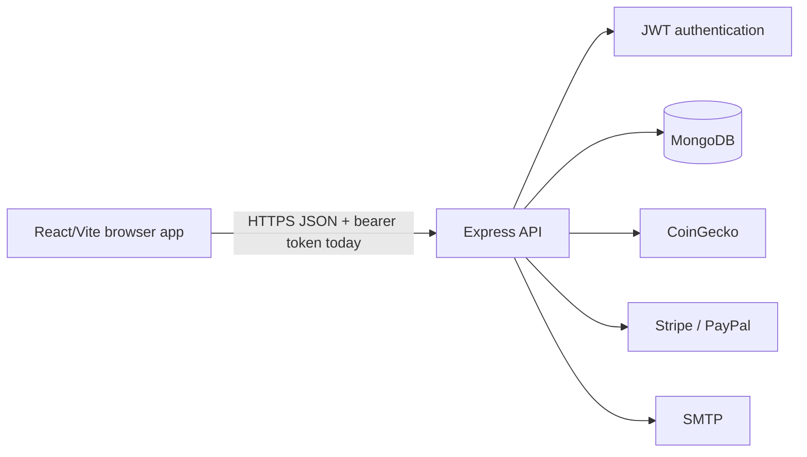

# CoinByte 2.0 Architecture

CoinByte 2.0 is a prototype React/Vite frontend backed by an Express API and MongoDB models. Wallet and payment capabilities are not production-ready until the hardening findings in `docs/audit/01-threat-model.md` are closed.

## Boundaries

- Browser to API: all request data is untrusted.
- API to MongoDB: only validated, allowlisted fields may cross this boundary.
- API to providers: provider responses are untrusted and must be bounded and schema-checked.
- Runtime configuration: secrets are supplied through environment variables and must never be committed.

## Planned hardened flow

1. Validate configuration at startup.
2. Authenticate and authorize at the route boundary.
3. Validate and normalize request bodies with explicit schemas.
4. Perform money operations using integer minor units and atomic database updates.
5. Return stable public errors while logging only redacted internal context.
