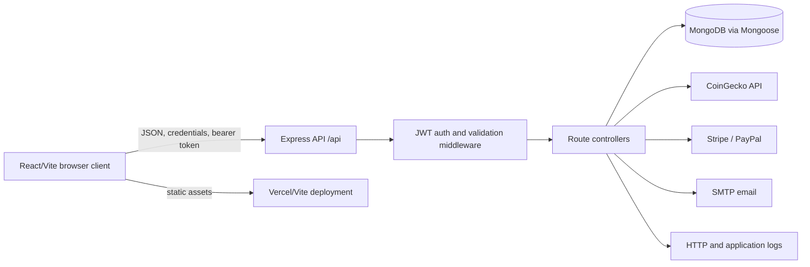

# CoinByte 2.0 Inventory

## Outcome under test
Harden CoinByte 2.0 so there are zero known secrets in the tree, zero high or critical dependency advisories, green lint, typecheck, and tests in CI, and a new developer can clone and run it from the README in under 10 minutes.

## Repository snapshot
- Repository: `Uuuuu77/CoinByte2.0`
- Starting branch: `master`
- Working branch: `hardening/coinbyte-2-0`
- Snapshot tag: `pre-hardening`
- Starting commit: `ae464f2`
- Runtime observed: Node.js `v24.16.0`, npm `11.13.0`

## What it is
A prototype full-stack cryptocurrency exchange UI and API. The frontend is a React 18 single-page application served by Vite. The backend is a CommonJS Express API backed by MongoDB through Mongoose. The API includes authentication, user data, wallets, trades, payments, social features, messaging, notifications, news, support, and subscriptions.

The current implementation is a prototype, not evidence of a production-safe exchange. Wallet and payment paths are value-sensitive and require priority review.

## Entry points and runtime

### Frontend
- Entry: `frontend/index.html` -> `frontend/src/main.jsx` -> `frontend/src/App.jsx`
- Framework/tooling: React 18, React Router 5, Vite 5
- Development command: `npm run dev` from `frontend/`
- Build command: `npm run build`
- Default development port: Vite's default, normally `5173`
- API client: `frontend/src/services/api.js` and `frontend/src/services/auth.js`

### Backend
- Entry: `backend/server.js`
- Framework/tooling: Node.js, Express 4, Mongoose 8
- Start command: `npm start` from `backend/`
- Default port: `5000`
- API prefix: `/api`
- Route registry: `backend/routes/index.js`
- Middleware currently includes CORS, JSON body size limit, Helmet, Morgan, Mongo sanitization, authentication/validation middleware, and centralized error middleware.

## Package managers and dependencies
Both applications use npm and commit a package lockfile:
- `backend/package.json`, `backend/package-lock.json`
- `frontend/package.json`, `frontend/package-lock.json`

The backend has production dependencies for MongoDB/Mongoose, JWT authentication, bcrypt/bcryptjs, Stripe, PayPal, Nodemailer, Google APIs, HTTP calls, validation, security middleware, and logging. The frontend uses React, Axios, Chart.js, React Router, and Vite tooling.

## Environment variables observed
The workspace supplies these names to the project environment: `API_KEY`, `COINGECKO_API_BASE_URL`, `EMAIL`, `EMAIL_PASSWORD`, `JWT_SECRET_KEY`, `MONGO_URI`, `NEXT_PUBLIC_DEV_SUPABASE_REDIRECT_URL`, `PAYPAL_CLIENT_ID`, `PAYPAL_CLIENT_SECRET`, `REACT_APP_API_BASE_URL`, `SMTP_HOST`, `SMTP_PORT`, and `SMTP_SECURE`.

Source references also include `PORT`, `JWT_SECRET`, Stripe configuration, and other payment/mail configuration candidates. The authoritative required-variable list must be derived during the hardening work without printing values. The local `.env.development.local` is ignored by the global gitignore and was not read.

## External services and data stores
- MongoDB via `MONGO_URI`
- CoinGecko market-data HTTP API via `COINGECKO_API_BASE_URL`
- SMTP email via SMTP variables and `EMAIL`/`EMAIL_PASSWORD`
- Stripe payment provider
- PayPal payment provider
- Google APIs dependency is present and needs caller tracing
- Vercel frontend configuration exists at `frontend/vercel.json`

## Value, identity, and input surfaces
- Authentication: registration, login, current-user lookup, JWT middleware
- Wallets: balances, deposits, withdrawals, transfers, transaction history
- Payments: Stripe and PayPal routes
- Trades: market data, transaction history, trade forms
- User-controlled text: social posts/comments, messages, support tickets, subscriptions, profile data
- External responses: CoinGecko and payment provider responses
- Frontend input is sent over Axios to backend routes; backend JSON parsing accepts up to 10 KB before route validation.

## Data flow

## Trust boundaries
1. Browser to API: the attacker controls all request bodies, headers, tokens, route parameters, and timing.
2. API to MongoDB: application queries and updates determine identity scoping, balance integrity, and injection exposure.
3. API to CoinGecko: external data is untrusted and can be unavailable, malformed, stale, or rate-limited.
4. API to payment providers: provider credentials and callback/request data affect payment state and value movement.
5. API to SMTP and logs: user-controlled content may become email content or log content; secrets must not be emitted.
6. Deployment environment to process: environment variables contain credentials and security configuration.
7. Frontend to user browser: bundled code and API responses are visible to users and must never contain server secrets.

## Baseline record
Exact command output is stored under `/tmp/coinbyte-2-0/baseline/`.

Observed before hardening:
- Backend install state: dependencies were present; `npm ls --depth=0` completed with the installed tree.
- Backend tests: command exits green but only prints `No tests specified`.
- Frontend dependency state: dependencies were missing in the checkout; `npm ls --depth=0` reports unmet dependencies.
- Frontend lint: not successfully runnable because the frontend toolchain was missing.
- Frontend build: failed with `vite: command not found`.
- Backend build: no build script exists.
- Backend runtime: not started in Phase 0 because it requires a MongoDB connection and startup behavior must be measured separately after setup.

Baseline files:
- `environment.txt`
- `backend-dependency-tree.txt`
- `frontend-dependency-tree.txt`
- `backend-test.txt`
- `frontend-lint.txt`
- `frontend-build.txt`

## Confusion Protocol items
1. **Authentication configuration mismatch:** source references both `JWT_SECRET` in the README and `JWT_SECRET_KEY` in the workspace environment. Confirm the canonical name from `backend/config/auth.js` and all callers before changing configuration.
2. **Payment scope ambiguity:** the prototype exposes Stripe and PayPal routes, but it is unclear whether they are intended to process real money in this repository or are placeholders. Because they can move value, they are treated as Critical until proven otherwise.
3. **Two frontend API deployment models are plausible:** direct browser calls using `REACT_APP_API_BASE_URL`, or a Vercel proxy/rewrite from the frontend. Inspect `frontend/vercel.json`, Axios setup, and deployment behavior before choosing a single documented model.
4. **Supersession is unknown:** the README does not name the repository that supersedes this prototype. The hardening docs will describe this as a prototype until the owner supplies the successor repository name.
5. **License status is inconsistent:** README links to MIT, but no tracked `LICENSE` file was found in the initial map. Ask for the correct license before creating one.
